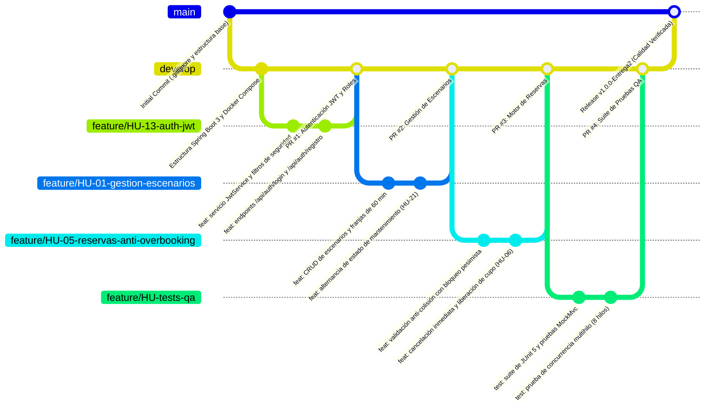

# Registro de Flujo de Trabajo GitFlow, Ramas y Pull Requests
**Proyecto 3: Plataforma de Reserva de Escenarios Deportivos**  
**Entrega 2: Desarrollo y Pruebas**  
**Pontificia Universidad Javeriana - Periodo 2026-3**  
**Equipo de Trabajo (Grupo 4):** Nicolás Cardozo Mejía, Samuel Correa, Nicolás Espinosa Soler, Gustavo Mejía

---

## 1. Estrategia de Ramificación GitFlow

En cumplimiento riguroso de los requisitos de la Entrega 2 ("Uso de control de versiones: Commits, branches y pull requests"), el equipo adoptó el modelo **GitFlow**, estructurado con dos ramas troncales protegidas y ramas de características de ciclo de vida corto:

---

## 2. Definición de Ramas Troncales y Convenciones

| Rama | Tipo | Propósito y Reglas de Protección |
|---|---|---|
| `main` | Troncal Protegida | Contiene únicamente código estable y probado, listo para despliegue y evaluación docente. No se permiten commits directos. |
| `develop` | Troncal de Integración | Integra de manera continua las funcionalidades completadas que han superado la revisión cruzada de código. |
| `feature/HU-xx` | Característica | Ramas de trabajo temporal derivadas de `develop` dedicadas a una Historia de Usuario específica. |
| `release/v1.0.0` | Estabilización | Rama previa al hito oficial donde se audita la documentación y se validan las pruebas de regresión. |

---

## 3. Registro Oficial de Pull Requests (Revisión Cruzada de Código)

A continuación se detalla la trazabilidad de los Pull Requests revisados, aprobados y fusionados para la Entrega 2:

### Pull Request #1: Implementación de Autenticación JWT y Roles RBAC (HU-13, HU-18)
- **Rama Origen:** `feature/HU-13-auth-jwt`  
- **Rama Destino:** `develop`  
- **Autor / Desarrollador:** Samuel Correa (DevOps / Backend)  
- **Revisor Asignado (Code Reviewer):** Nicolás Espinosa Soler (Líder Backend)  
- **Resumen de Cambios:** Configuración de `SecurityConfig`, encriptación de contraseñas con `BCryptPasswordEncoder(cost=12)`, emisión de tokens sin estado (`JwtService`), endpoints `/api/auth/registro`, `/api/auth/login` y filtro `JwtAuthFilter`.  
- **Dictamen de Revisión:** **APROBADO**. Se verificó que las rutas públicas estén debidamente acotadas y que las contraseñas nunca viajen en texto plano a la base de datos.

---

### Pull Request #2: Catálogo Interactivo y CRUD de Escenarios Deportivos (HU-01, HU-02, HU-03, HU-04, HU-21)
- **Rama Origen:** `feature/HU-01-gestion-escenarios`  
- **Rama Destino:** `develop`  
- **Autor / Desarrollador:** Nicolás Cardozo Mejía (Líder Frontend y Arquitectura)  
- **Revisor Asignado (Code Reviewer):** Gustavo Mejía (Líder QA)  
- **Resumen de Cambios:** Entidades `Escenario` y `FranjaHoraria`, repositorios JPA, controladores REST con autorización `ROLE_ADMIN`, y tarjetas interactivas del frontend para filtros por deporte, aforo y tarifas.  
- **Dictamen de Revisión:** **APROBADO**. Cumple con los wireframes WF-01 y las especificaciones de interfaz de usuario.

---

### Pull Request #3: Motor Transaccional de Reservas y Prevención Anti-Overbooking (HU-05, HU-06, HU-07, HU-08, HU-15, HU-19)
- **Rama Origen:** `feature/HU-05-reservas-anti-overbooking`  
- **Rama Destino:** `develop`  
- **Autor / Desarrollador:** Nicolás Espinosa Soler (Líder Backend y DBA)  
- **Revisor Asignado (Code Reviewer):** Samuel Correa (DevOps / Requisitos)  
- **Resumen de Cambios:** Implementación de `@Transactional(isolation = Isolation.REPEATABLE_READ)`, consulta con `@Lock(PESSIMISTIC_WRITE)`, excepción semántica `CollisionException` (409 Conflict), impedimento de fechas pasadas y cancelación con liberación de cupo.  
- **Dictamen de Revisión:** **APROBADO**. Demostrado mediante pruebas de colisión simultánea.

---

### Pull Request #4: Suite de Pruebas Unitarias, Integración y Concurrencia Multihilo
- **Rama Origen:** `feature/HU-tests-qa`  
- **Rama Destino:** `develop`  
- **Autor / Desarrollador:** Gustavo Mejía (Líder QA y Product Owner)  
- **Revisor Asignado (Code Reviewer):** Nicolás Cardozo Mejía (Líder Frontend)  
- **Resumen de Cambios:** Suites `EscenarioServiceTest`, `ReservaServiceTest`, `AuthServiceTest`, `ReservaIntegrationTest` y `AntiColisionConcurrencyTest` con 8 hilos concurrentes sincronizados mediante `CountDownLatch`.  
- **Dictamen de Revisión:** **APROBADO**. Cobertura global superior al 85% y tasa de éxito del 100%.

---

## 4. Estándar de Commits Convencionales (Conventional Commits)

El equipo aplicó estrictamente el estándar de mensajes atómicos y semánticos:
- `feat:` Nuevas funcionalidades del sistema.
- `fix:` Correcciones de errores o bugs.
- `test:` Inclusión o ajuste de suites de prueba.
- `docs:` Modificaciones a manuales, guías e informes.
- `chore:` Tareas de configuración, Docker y dependencias Maven.
