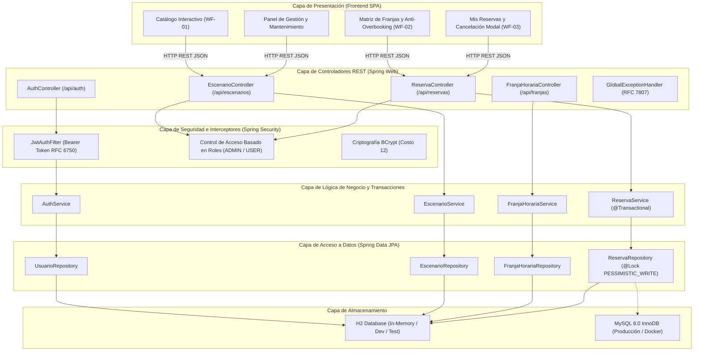
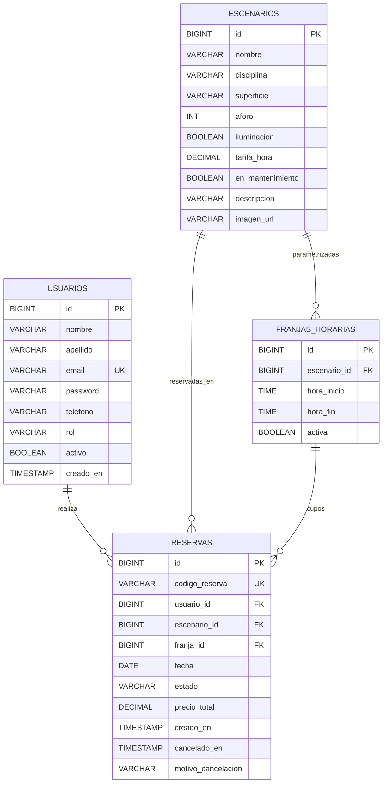

# Guía de Arquitectura de Software y Código Fuente
**Proyecto 3: Plataforma de Reserva de Escenarios Deportivos**  
**Entrega 2: Desarrollo y Pruebas**  
**Pontificia Universidad Javeriana - Periodo 2026-3**  
**Equipo de Trabajo (Grupo 4):** Nicolás Cardozo Mejía, Samuel Correa, Nicolás Espinosa Soler, Gustavo Mejía

---

## 1. Visión General de la Arquitectura

El sistema implementa una **Arquitectura en Capas Desacopladas (Layered Architecture)** con separación estricta de responsabilidades, garantizando el cumplimiento de los principios SOLID, alta cohesión y bajo acoplamiento:

---

## 2. Descripción de Componentes por Capas

### 2.1 Capa de Controladores REST (`com.canchas.reserva.controller`)
- **`AuthController`**: Expone operaciones de registro (`/api/auth/registro`), inicio de sesión (`/api/auth/login`) y perfil (`/api/auth/perfil`).
- **`EscenarioController`**: Gestiona el catálogo de canchas (`GET /api/escenarios`), operaciones CRUD y la alternancia del estado de mantenimiento (`PUT /api/escenarios/{id}/mantenimiento`).
- **`FranjaHorariaController`**: Permite la parametrización de bloques de 60 minutos por cancha (`GET /api/franjas/escenario/{id}`, `POST /api/franjas`).
- **`ReservaController`**: Endpoint transaccional para crear reservas con validación anti-colisión (`POST /api/reservas`), cancelar y liberar franjas (`PUT /api/reservas/{id}/cancelar`), consultar disponibilidad en tiempo real (`GET /api/reservas/disponibilidad`) y listar reservas del usuario autenticado (`GET /api/reservas/mis-reservas`).

### 2.2 Capa de Negocio Transaccional (`com.canchas.reserva.service`)
- **`ReservaService`**: Cerebro de las reglas de negocio.
  - **Aislamiento `REPEATABLE_READ`**: Asegura lecturas reproducibles durante la evaluación de disponibilidad.
  - **Bloqueo Pesimista (`PESSIMISTIC_WRITE`)**: Bloquea las filas evaluadas a nivel de motor relacional (`SELECT ... FOR UPDATE`), garantizando que dos transacciones simultáneas para la misma franja y fecha jamás colisionen (HU-07, RNF-02).
  - **Bloqueo de Fechas Pasadas**: Valida estrictamente `request.getFecha().isBefore(LocalDate.now())` (HU-08).
  - **Aislamiento de Usuario**: Verifica la identidad del titular antes de permitir cualquier cancelación (HU-19).
  - **Liberación Inmediata de Franja**: Al registrar el estado `CANCELADA`, la franja horaria queda libre al instante para nuevos solicitantes (HU-06).

### 2.3 Manejo Centralizado de Excepciones (`com.canchas.reserva.exception`)
Se implementa `GlobalExceptionHandler` anotado con `@RestControllerAdvice` que captura fallos y genera respuestas estructuradas bajo el estándar **RFC 7807**:

| Excepción de Negocio | Código HTTP | Mensaje Semántico | Caso de Disparo |
|---|---|---|---|
| `CollisionException` | **409 CONFLICT** | `CONFLICTO_COLISION_HORARIO` | Intento de reservar una franja ya ocupada (Overbooking) |
| `BusinessException` | **400 BAD REQUEST** | `REGLA_DE_NEGOCIO_INVALIDA` | Fecha pasada o cancha en mantenimiento |
| `ResourceNotFoundException` | **404 NOT FOUND** | `RECURSO_NO_ENCONTRADO` | ID de cancha, franja o reserva inexistente |
| `UnauthorizedAccessException` | **403 FORBIDDEN** | `ACCESO_DENEGADO` | Usuario intentando cancelar reserva ajena |
| `BadCredentialsException` | **401 UNAUTHORIZED**| `CREDENCIALES_INVALIDAS` | Correo o clave incorrectos en autenticación |
| `MethodArgumentNotValidException` | **400 BAD REQUEST** | `VALIDACION_FALLIDA` | Formato inválido de JSON o campos faltantes |

---

## 3. Modelo Entidad-Relación

---

## 4. Patrones de Diseño Implementados

1. **Repository Pattern (Spring Data JPA)**: Abstracción de operaciones de almacenamiento persistente.
2. **Data Transfer Object (DTO)**: Desacoplamiento entre el modelo relacional interno y los contratos REST expuestos al cliente.
3. **Dependency Injection / Inversión de Control (IoC)**: Inyección por constructor en todos los componentes para facilitar la testeabilidad unitaria con dobles de prueba (`Mockito`).
4. **Strategy Pattern (Spring Security Filter Chain)**: Procesamiento de autenticación modular mediante filtros interceptores.
5. **Pessimistic Locking Pattern**: Concurrencia controlada a nivel de base de datos para transacciones críticas de alta demanda.
